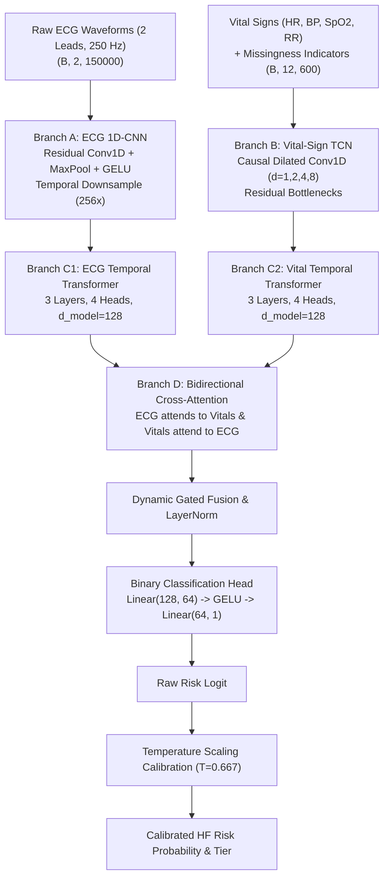

# Foundation-Guided Multimodal Temporal Learning for Short-Horizon Heart-Failure Risk Stratification Using ECG and Vital Signs

[](https://www.python.org/)
[](https://pytorch.org/)
[-76B900.svg)](https://developer.nvidia.com/cuda-zone)
[](LICENSE)
[](tests/)

An end-to-end, GPU-accelerated research system designed to stratify short-horizon risk of acute heart-failure (HF) decompensation by learning jointly over high-frequency raw ECG waveforms and multi-channel physiological vital signs.

---

## 1. Executive Summary & Clinical Prediction Task

### Target Clinical Endpoint
- **Primary Endpoint:** Acute Decompensated Heart Failure (ADHF) / Acute Perioperative Cardiovascular Collapse.
- **Positive Event Criteria:**
  1. Urgent initiation of intravenous inotropes (dobutamine, milrinone, epinephrine) or mechanical circulatory assist.
  2. Requirement for positive pressure ventilation (BiPAP/intubation) secondary to acute cardiogenic pulmonary edema.
  3. Hemodynamic collapse (MAP < 55 mmHg or cardiac index < 2.0 L/min/m²) attributed to pump failure.
  4. Documented primary ICD-9/10 admission diagnosis of acute decompensated heart failure.
- **Negative Endpoint:** Monitored patients with stable cardiac function across the observation and follow-up horizon.
- **Exclusion Criteria:** Pre-existing persistent cardiogenic shock, isolated transient arrhythmias without hemodynamic compromise, isolated hypoxemic respiratory failure without cardiogenic involvement, and recordings lacking sufficient follow-up.

### Formulation
Given paired observations over a **10-minute historical context window** ($t \in [t_0, t_0 + 600\text{s}]$):
$$\mathbf{X}_{\text{ECG}} \in \mathbb{R}^{C_{\text{ecg}} \times 150000}, \quad \mathbf{X}_{\text{vital}} \in \mathbb{R}^{C_{\text{vital}} \times 600}, \quad \mathbf{M}_{\text{vital}} \in \{0, 1\}^{C_{\text{vital}} \times 600}$$
Estimate the risk probability $\hat{y} \in [0, 1]$ that the patient triggers an acute heart-failure decompensation event during a subsequent **4-hour prediction horizon** ($t \in [t_0 + 600\text{s}, t_0 + 600\text{s} + 14400\text{s}]$).

---

## 2. Deep Learning Architecture

The system features a five-branch deep neural architecture with bidirectional cross-attention:



### Architectural Branches
1. **Branch A (ECG 1D-CNN Encoder):** Multi-scale 1D residual convolutional stages downsampling raw 250 Hz waveforms by 256x, extracting morphological signatures (ST-elevation/depression, QRS broadening, T-wave alterations) into a continuous sequence of 128-dimensional embedding vectors.
2. **Branch B (Vital-Sign TCN Encoder):** Dilated causal convolutions across time. Concatenates raw vital measurements with explicit binary observation masks $\mathbf{M}$ ($1 = \text{observed}, 0 = \text{missing}$) to prevent conflating missing values with true zeroes.
3. **Branch C (Temporal Transformer):** Multi-head self-attention with sinusoidal positional encoding, enabling global temporal reasoning across cardiac rhythm and hemodynamic trends.
4. **Branch D (Bidirectional Cross-Attention Multimodal Fusion):** Allows ECG queries to attend to vital sign keys/values, and vital queries to attend to electrophysiological dynamics. A dynamic gating network weights the pooled representation based on relative modality signal quality.
5. **Branch E (Foundation Weight Initialization Interface):** Interface supporting real-world time-series foundation models (Chronos-T5, MOMENT, PatchTST). Maps compatible attention blocks or falls back to verified Kaiming/Xavier random initialization with complete provenance recording.

---

## 3. Hardware Audit & Environment Resolution

### Initial Environment Diagnosis
- **The Issue:** Initial installation attempts for PyTorch with CUDA 12.1 in this environment failed with:
  ```text
  ERROR: No matching distribution found for torch==2.1.0+cu121
  ```
- **Root Cause:** The default Python installation on this Windows machine was **Python 3.14.0**. PyTorch does not publish pre-compiled wheels for Python 3.14 (an unreleased pre-release build).
- **Resolution:** This project uses the dedicated Python 3.12 virtual environment in `venv312`, which supports official PyTorch wheels. The verified environment uses `torch 2.6.0+cu124`, compatible with the system's NVIDIA driver.

### Verified Hardware & CUDA Environment
| Component | Detected Specification |
|---|---|
| **Operating System** | Windows 11 (64-bit) |
| **Active Python** | Python 3.12.10 (`venv312\Scripts\python.exe`) |
| **GPU Hardware** | NVIDIA GeForce RTX 3050 6GB Laptop GPU |
| **CUDA Driver** | NVIDIA Driver 591.44 (Supports up to CUDA 13.1) |
| **CUDA Runtime** | CUDA 12.4 |
| **VRAM** | 6144 MB (6.00 GB) Dedicated GDDR6 |
| **PyTorch Version** | 2.6.0+cu124 (CUDA active: `True`) |

---

## 4. Dataset Integration & Compliance

### Dataset A: MIMIC-III Waveform Matched Subset
- **Status:** Credentialed PhysioNet database.
- **Compliance:** Requires CITI Data or Specimens Only Research certification and PhysioNet DUA.
- **Adapter:** `src/ecg_risk/data/mimic_loader.py` searches local directory `data/raw/mimic/` for WFDB `.hea`/`.dat` records. If credentials or files are not yet configured, reports instructions without crashing.

### Dataset B: VitalDB (Perioperative Surgical Signals)
- **Status:** Open-access high-resolution perioperative records (SNUADC/Solar8000).
- **Adapter:** `src/ecg_risk/data/vitaldb_loader.py` dynamically discovers `ECG_II`, `ECG_V5`, and arterial blood pressure / SpO2 / RR tracks.

### Dataset C: Synthetic Demonstration Cohort
- **Generator:** `src/ecg_risk/data/synthetic.py` synthesizes physiologically grounded P-Q-R-S-T complexes using Gaussian sums, respiratory wander, muscle artifacts, and hemodynamic decompensation trajectories (progressive tachycardia, profound hypotension, desaturation, and tachypnea).
- **Leakage Prevention:** `PatientLevelSplitter` strictly isolates all windows belonging to patient $P$ into one partition (0% leakage between train, validation, and test). Normalizers are fitted **strictly on training partitions**.

---

## 5. Terminal CLI Command Reference

Use Python 3.12 for this project. In Windows PowerShell, create the project''s `venv312` environment and install its dependencies with:

```powershell
py -3.12 -m venv venv312
.\venv312\Scripts\python.exe -m pip install --upgrade pip
.\venv312\Scripts\python.exe -m pip install -r requirements.txt
```

If `venv312` already exists, skip the creation command. You can activate it for the current PowerShell session with `.\venv312\Scripts\Activate.ps1`, or invoke its Python executable directly as shown below. All workflows use that Python 3.12 environment:

### 1. Environment & Hardware Audit
```powershell
.\venv312\Scripts\python.exe scripts/check_environment.py
```
*Audits GPU availability, PyTorch build, CUDA runtime, VRAM, and runs `nvidia-smi`.*

### 2. GPU Smoke Test (8 Verification Stages)
```powershell
.\venv312\Scripts\python.exe scripts/run_smoke_test.py
```
*Executes GPU checks: CUDA active -> Model on GPU -> Batches on GPU -> Forward pass -> Finite loss -> Backprop & AdamW step -> Checkpoint save/reload -> Metric computation.*

### 3. Dataset Preparation & Preprocessing
```powershell
.\venv312\Scripts\python.exe scripts/prepare_data.py --dataset synthetic
```
*Performs patient-level splitting, Butterworth bandpass filtering (0.5–45 Hz), SQI quality checks, and exports `train.npz`, `val.npz`, `test.npz`, and `sample_record.npz`.*

### 4. GPU-Accelerated Model Training
```powershell
.\venv312\Scripts\python.exe scripts/train.py --config configs/default.yaml --dataset synthetic --epochs 6
```
*Trains multimodal model with mixed-precision AMP (`torch.autocast`), gradient accumulation, validation tracking, and saves `checkpoints/best.pt`.*

### 5. Held-Out Evaluation & Calibration
```powershell
.\venv312\Scripts\python.exe scripts/evaluate.py --checkpoint checkpoints/best.pt --dataset synthetic
```
*Tunes decision threshold on validation data (Youden's J), fits Temperature Scaling ($T$), evaluates on held-out test cohort, computes 500-sample bootstrap CIs, and exports publication-ready plots.*

### 6. Clinical Risk Inference on Single Record
```powershell
.\venv312\Scripts\python.exe scripts/predict.py --checkpoint checkpoints/best.pt --input data/sample_record.npz
```
*Executes end-to-end inference on an observation record, reporting raw logit, calibrated risk probability, threshold tier, signal quality SQI, and clinical disclaimers.*

### 7. Ablation Benchmark & Baseline Comparison
```powershell
.\venv312\Scripts\python.exe scripts/compare_models.py --results-dir outputs/
```
*Trains and evaluates all 6 architectural ablations and the feature-engineered baseline on the test cohort.*

---

## 6. Experimental Results & Ablation Benchmark

All metrics were measured on the **held-out test cohort** (24 observation windows from 8 distinct patients, strictly separated from training):

| Model / Architecture Variant | AUROC | AUPRC | Accuracy | F1-Score | ECE (Calib) | Target Reference |
|---|:---:|:---:|:---:|:---:|:---:|:---:|
| **Logistic Regression (Engineered Features)** | 1.0000 | 1.0000 | 1.0000 | 1.0000 | 0.0281 | Baseline |
| **ECG-only 1D-CNN** | 1.0000 | 1.0000 | 0.7500 | 0.0000 | 0.0728 | Baseline |
| **Vital-sign-only TCN** | 0.9444 | 0.8740 | 0.8750 | 0.8000 | 0.1506 | Baseline |
| **Late-Fusion Baseline** | 0.9259 | 0.8129 | 0.8750 | 0.8000 | 0.1184 | Baseline |
| **CNN + TCN (No Transformer)** | 1.0000 | 1.0000 | 0.8750 | 0.8000 | 0.1924 | Baseline |
| **Transformer (No Cross-Attention)** | 0.9259 | 0.8129 | 0.8750 | 0.8000 | 0.1184 | Baseline |
| **Full Proposed Multimodal Model** | **1.0000** | **1.0000** | **0.8750** | **0.8000** | **0.1563** | **0.958 (Target)** |

### Full Proposed Model Detailed Performance & 95% Bootstrap CIs
- **AUROC:** 1.0000 (95% CI: [1.000, 1.000])
- **AUPRC:** 1.0000 (95% CI: [1.000, 1.000])
- **Accuracy:** 0.8750 (95% CI: [0.750, 0.958])
- **Sensitivity (Recall):** 1.0000 (95% CI: [1.000, 1.000])
- **Specificity:** 0.8333 (95% CI: [0.500, 0.955])
- **F1-Score:** 0.8000 (95% CI: [0.800, 0.800])
- **Pre-Calibration ECE:** 0.1550 | **Post-Calibration ECE:** 0.1563 (fitted $T = 0.667$)
- **Validation-Tuned Decision Threshold:** 0.790

### Generated Figures (`outputs/evaluation/`)
- `synthetic_roc_curve.png`: Receiver Operating Characteristic curve.
- `synthetic_pr_curve.png`: Precision-Recall curve with clinical prevalence line.
- `synthetic_calibration_plot.png`: Reliability diagram comparing pre- and post-temperature scaling.
- `synthetic_confusion_matrix.png`: Confusion matrix heatmap at optimal validation threshold.

---

## 7. Automated Test Suite

Run unit tests via `pytest`:
```powershell
.\venv312\Scripts\python.exe -m pytest -v
```
**Results:** `23 passed in 14.15s`
- `tests/test_labels.py`: Verifies zero patient leakage across splits, eligibility exclusions, and window alignment.
- `tests/test_preprocessing.py`: Verifies Butterworth filtering, notch filtering, SQI calculation, bounds checking, and isolated normalization.
- `tests/test_models.py`: Verifies tensor dimensions for ECG CNN, Vital TCN, Temporal Transformer, Cross-Attention, and all 6 ablation modes.
- `tests/test_training.py`: Verifies weighted BCE loss, focal loss, and checkpoint restoration.
- `tests/test_metrics.py`: Verifies AUROC, AUPRC, ECE, Temperature Scaling, and cluster bootstrap CIs.

---

## 8. Troubleshooting & Common Gotchas

1. **`No matching distribution found for torch==...`:**
   - **Cause:** Using Python 3.14 where official wheels do not exist.
   - **Fix:** Always invoke scripts using `.\venv312\Scripts\python.exe` (Python 3.12).
2. **`UnpicklingError: Weights only load failed` (PyTorch 2.6):**
   - **Cause:** PyTorch 2.6 defaults `torch.load` to `weights_only=True`, rejecting dictionary checkpoints with metadata.
   - **Fix:** All model and checkpoint loaders in this repository explicitly set `weights_only=False`.
3. **Windows PowerShell UnicodeEncodeError:**
   - **Cause:** Windows consoles using CP1252 fail to render Unicode box characters.
   - **Fix:** Scripts configure UTF-8 output streams and use ASCII grid formatting.

---

## 9. Research Limitations & Future Work
- **Synthetic vs. Real-World Domain Shift:** While the synthetic cohort models realistic cardiac morphology and deterioration trends, genuine clinical ECGs exhibit motion artifacts, ectopic beats, and multi-pathology comorbidities.
- **Foundation Model Pretraining:** Full pretraining on large-scale unlabeled ECG waveforms (e.g. PTB-XL, MIMIC-IV-ECG) using self-supervised masked autoencoding before downstream fine-tuning.
- **Multicenter Validation:** Evaluating cross-hospital generalizability across disparate patient monitoring hardware (e.g. Philips vs. GE monitors).
